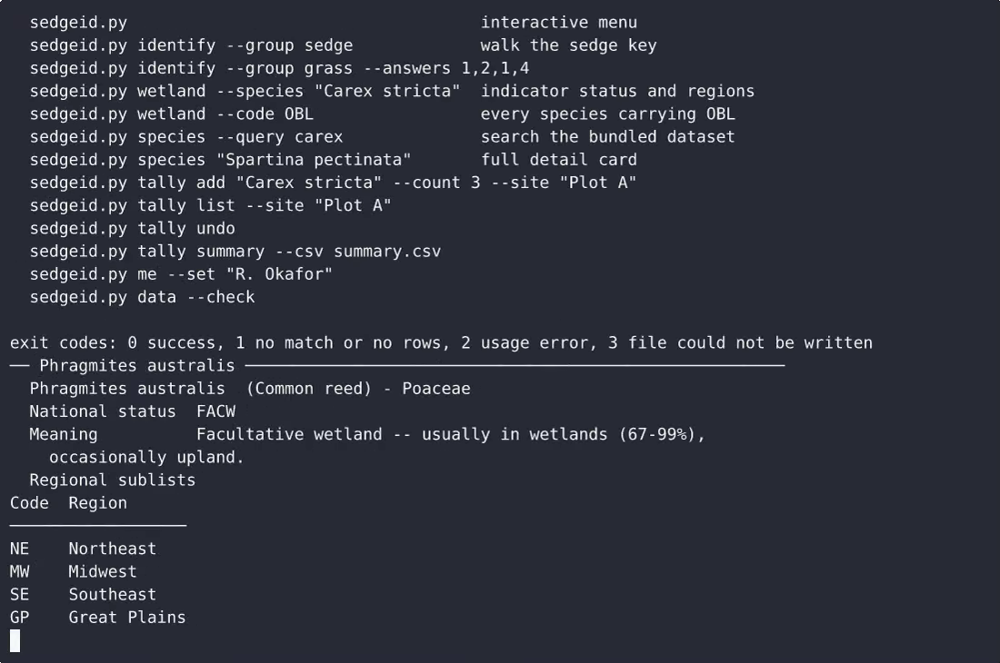
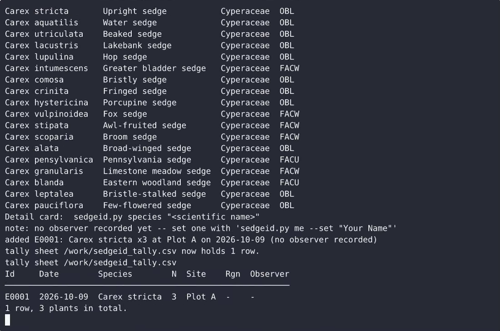

# SedgeID — complete Full-stack app command-line tool example app

**SedgeID** is a production-grade command-line tool written in Full-stack app — generated by cenius.ai, Apache-2.0-licensed. SedgeID is a single-file, standard-library Python command-line tool for field botanists working with sedges and grasses. Clone SedgeID, run the installer, done — you have a working product in minutes. Want to change something? [Open SedgeID on cenius.ai](https://cenius.ai/marketplace/p/sedgeid?ref=gh&utm_campaign=sedgeid-webapp) and say what you need — a revised build ships back, ready to deploy.


[](LICENSE)  [](https://cenius.ai)

[](https://cenius.ai/marketplace/p/sedgeid?ref=gh&utm_campaign=sedgeid-webapp)

> **▶ [Open & edit in cenius.ai](https://cenius.ai/marketplace/p/sedgeid?ref=gh&utm_campaign=sedgeid-webapp)** — one click to an editable workspace: describe changes in plain English, get an instant preview, one-click deploy and host. Modifications made on the platform come with full rebrand & relicense rights.

_Local clone? See [Quick start](#quick-start) below. cenius.ai is the zero-setup path._

## Demo


▶ **[Video walkthrough](https://cenius.ai/marketplace/p/sedgeid?ref=gh&utm_campaign=sedgeid-webapp)** — see the app in action on the cenius.ai project page · [MP4 file](.github/media/demo.mp4)

## Screenshots

 

## Quick start

```bash
./install.sh   # installs dependencies + seeds demo data
```

See [`INSTALL.md`](INSTALL.md) for full setup and usage instructions.

## Features

- Interactive dichotomous key identification
- Wetland indicator status lookup (national list + region field)
- Botanical survey tally sheet with CSV persistence
- Bundled starter species and trait dataset
- Species browse and name/family search
- Tally summary counts
- Local observer identity and defaults

## Architecture

Full-stack app project, delivered as a complete runnable codebase (12 files). Kick off `./install.sh` to pull packages and seed the database, then the app is up. Installation walkthrough: [`INSTALL.md`](INSTALL.md).

## Usage guide

Every capability is available twice: interactively through the numbered menu and
non-interactively as a subcommand with flags. Nothing here needs the network.

```bash
python3 sedgeid.py            # the menu
python3 sedgeid.py --help     # the same commands, documented
```

### 1. The main menu

Running the tool with no arguments prints a banner with the dataset version, the
seven numbered choices and a prompt:

```
────────────────────────────────────────────────────────────────────────────────
SedgeID 1.0.0  sedge & grass identification  (dataset 2025.1)
  1) Identify a plant   walk the dichotomous sedge/grass key
  2) Wetland status     indicator codes, meanings and regions
  3) Species            browse and search the bundled dataset
  4) Tally              record observations in sedgeid_tally.csv
  5) Observer           who is recording this survey
  6) Dataset            integrity check and coverage
  7) Help               usage for every command
  q) Quit
  Select 1-7, q to quit:
```

Enter a number, or `q` / Enter / Ctrl-D to leave. A dataset integrity warning,
if one ever occurred, prints as a single line above the list and the menu keeps
working; the affected command refuses and says why.

### 2. Identifying a plant

```bash
python3 sedgeid.py identify --group sedge     # interactive
python3 sedgeid.py identify --group grass     # interactive
python3 sedgeid.py identify                   # asks group: sedge / grass / not sure
```

Each screen is one couplet with 2-4 numbered choices plus three helpers:

_Full guide: [`USAGE.md`](USAGE.md)_

## FAQ

### Can I deploy SedgeID on my own infrastructure?

Grab the repo and run `./install.sh` — it handles packages and seed data in one go. After that, [`INSTALL.md`](INSTALL.md) walks you through starting the server. No external accounts required.

### Is there a no-code way to modify SedgeID?

The easiest route: [visit the project on cenius.ai](https://cenius.ai/marketplace/p/sedgeid?ref=gh&utm_campaign=sedgeid-webapp), tell the platform what to change, and collect the updated build. No source-editing needed.

### How is SedgeID built technically?

Powered by Full-stack app. This repo is the real thing — full source, seed data, and all — ready to clone and start up. Highlights include wetland indicator status lookup (national list + region field).

### Can I build a business on SedgeID?

Yes. The code is Apache-2.0-licensed — use it, modify it, and ship it commercially. See [LICENSE](LICENSE).

### How do I customise SedgeID's branding?

Rebranding is straightforward under the MIT license — change what you want in the source. Or [open it on cenius.ai](https://cenius.ai/marketplace/p/sedgeid?ref=gh&utm_campaign=sedgeid-webapp): the platform handles the changes and grants full rebrand rights on the result.

## License & rebranding

Released under the [Apache License 2.0](LICENSE) (© 2026 Cenius AI) — free for personal and commercial use. The Cenius name/logo are trademarks (see NOTICE).

**Need a customized version?** [Remix this app on cenius.ai](https://cenius.ai/marketplace/p/sedgeid?ref=gh&utm_campaign=sedgeid-webapp) — modifications made on the platform come with **full rebrand & relicense rights** over your derivative.

## Built with cenius.ai

This entire application — code, design, seeded demo data — was generated on **[cenius.ai](https://cenius.ai)** from a plain-English description.

- 🚀 [Build your own app on cenius.ai](https://cenius.ai)
- 🎛️ [Remix SedgeID on the marketplace](https://cenius.ai/marketplace/p/sedgeid?ref=gh&utm_campaign=sedgeid-webapp) — open it in a workspace, prompt for changes, and ship your own version.

More open-source apps: [the Cenius-ai catalog](https://github.com/Cenius-ai) · [showcase index](https://github.com/Cenius-ai/showcase)
